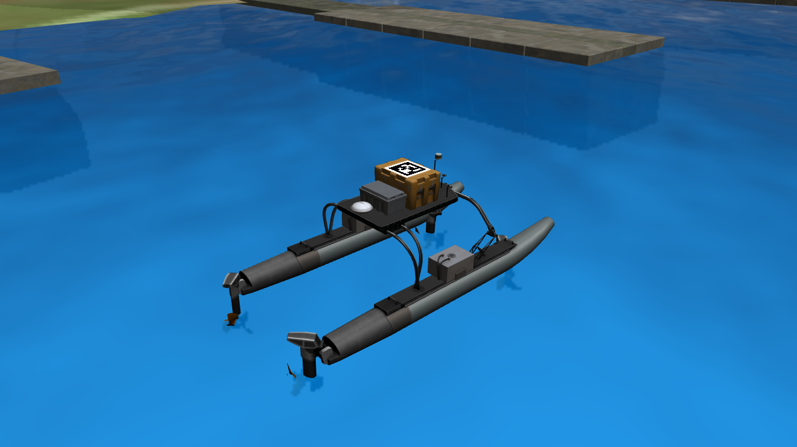
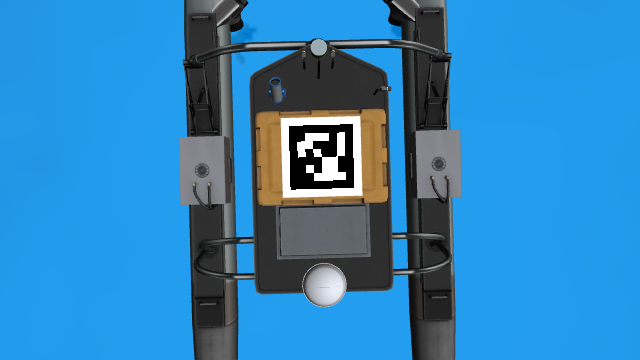
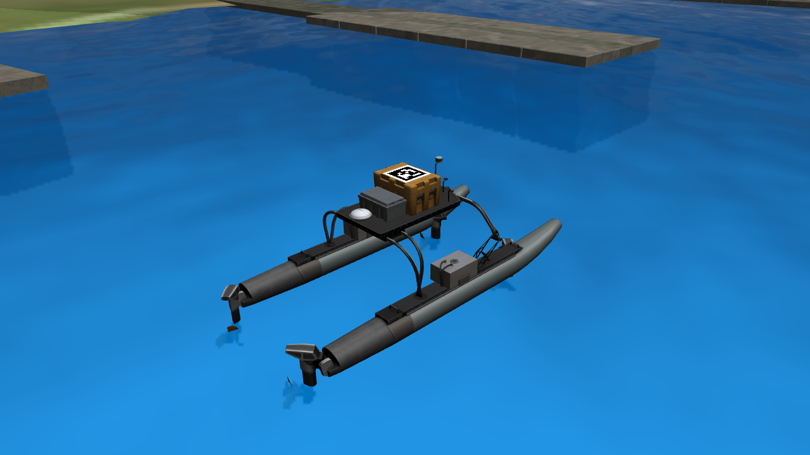
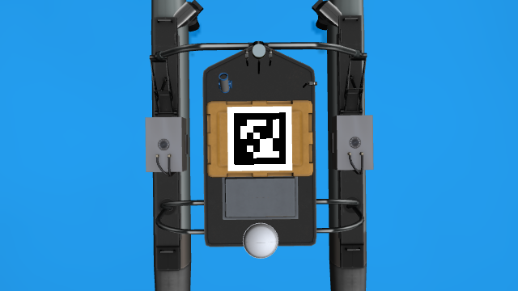
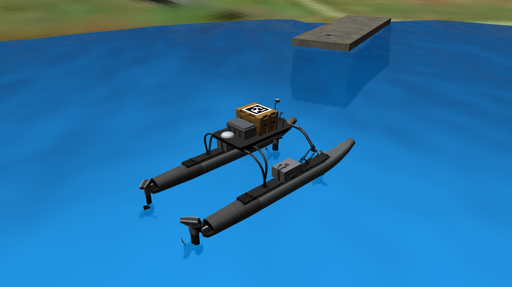
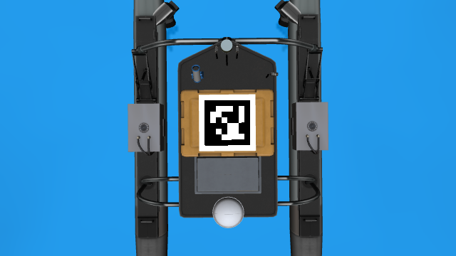

# 绕圈运动装配修复验收（2026-11-09）

本次修复只改变绕圈场景的运动实现。原Python脚本通过整模型接口给全部部件广播相同线速度，不能表达转动刚体不同位置的速度；整模型位姿更新还会保留已有的装配误差。新Gazebo 11系统插件缓存装配位姿，在每个物理步统一重建全部link，并分别设置角速度和质心速度。Python节点保留为监督节点。

## 验证设置

- Gazebo Classic 11.15.1、ROS Noetic、ODE，默认物理步长1ms；使用现有 `map1_circle.world` 和完整 `wamv_apriltag`，包含13个link。
- 参数保持半径5m、航速0.5m/s、横摇2°、纵摇1°、升沉0.03m，三个摇晃周期分别6／8／7秒。
- devel实例运行126.217秒**实际仿真时间**，覆盖默认两圈，采样4722次。实例仅省去无人机／PX4，以便独立执行时间复位；船、海面、模型插件和运动插件均为交付版本。
- 隔离install实例运行完整 `demo_uav_usv_circle.launch` 15.148秒仿真时间，采样559次，包含无人机、PX4和根命名空间MAVROS；MAVROS连接成功。
- 使用独立ROS／Gazebo master；运行器结束时清理自己创建的进程。未启动无人船导航或无人机控制、起飞、跟踪、降落任务。

原始汇总为 [devel_report.json](devel_report.json)、[install_report.json](install_report.json)，完整逐次采样为 [devel_samples.csv.gz](devel_samples.csv.gz) 和 [install_samples.csv.gz](install_samples.csv.gz)。位置／速度单位分别为m、m/s，角度／角速度单位为rad、rad/s；`stamp` 为ROS仿真时钟，汇总时长直接读取Gazebo世界时钟，避免把墙钟误作仿真时钟。

## 数值结果

表中为全部采样及13个link上的最大误差。姿态误差通过相对旋转矩阵计算，接近浮点精度时 `acos` 会形成约10⁻⁸rad的数值下限。

| 指标 | devel两圈 | install完整场景 | 验收上限 |
| --- | ---: | ---: | ---: |
| 相对装配位置 | 1.558e-8 m | 1.558e-8 m | 0.001 m |
| 相对装配姿态 | 2.958e-6 ° | 2.958e-6 ° | 0.1 ° |
| 轨迹半径 | 2.522e-8 m | 2.522e-8 m | 0.01 m |
| link原点间刚体速度关系 | 3.116e-5 m/s | 3.116e-5 m/s | 0.001 m/s |
| 对照解析轨迹的质心速度 | 1.151e-4 m/s | 1.085e-4 m/s | 0.001 m/s |
| 对照解析轨迹的角速度 | 4.007e-5 rad/s | 4.007e-5 rad/s | 0.001 rad/s |
| 升沉高度 | 1.227e-8 m | 1.226e-8 m | 0.001 m |

速度核验从SDF读取每个link的惯性质心偏移。Gazebo `LinkStates` 报告的是**link原点速度**：先用 `v_CoG = v_link + ω × R_link r_CoG` 换算观测速度，再与解析轨迹的 `v_ref + ω × (p_CoG - p_ref)` 比较。轨迹相位由连续展开的圆周角独立推导，不复用C++实现。表中的小量速度误差包含1ms物理步内积分的影响。

## 生命周期与回归

两种环境均通过暂停启动、墙钟心跳、暂停位姿与时钟不变、恢复运动、`rosnode kill /wamv/simulation/circle_motion` 正常停止、监督节点重新接管、强制终止监督进程后心跳超时恢复，以及无效半径启动失败检查。停止后13个link均恢复接管前的动态模式，线速度及角速度为零，暂停状态不变。

devel实例还在已运行两圈、轨迹相位已建立时执行时间复位。复位后重新从圆周起点计时，装配误差为1.433e-8m，按复位后仿真时间核对位置的误差为0.000501m。运动插件在模型插件之后、物理积分之前清除接管期间的外力，避免水动力时间历史跨越复位后产生非有限力，污染ODE运动学部件。

完整PX4场景在本环境调用 `/gazebo/reset_simulation` 后出现外部锁步时钟停滞；用最终插件复测仍在25秒墙钟超时内无法推进4秒仿真时间，见 [PX4复位边界记录](px4_reset_probe.json)。因此install完整场景检查监督节点重启和暂停恢复，时间归零检查由独立船实例承担。完整船机场景需要重新开始时，应重启场景及SITL；此次没有修改PX4或飞行控制代码。

Python的53项地图／launch／工具／监督回归及C++的6项轨迹数学检查通过。数学测试包括顺逆时针、零航速、关闭摇晃、四元数导数对应世界角速度、带质心偏移的独立有限差分速度验证。[preserved_files.json](preserved_files.json) 记录本轮开始时的逐文件SHA256和范围核对结果：共享SDF、其他Demo、地图、`std_usv` 和 `lite_quad_uav` 的既有内容保持不变。

复现命令见 [使用说明](../demo_launches.md#推进器装配修复验收)。运行器为 `test/circle_motion_runtime_check.py`，默认126秒；`--full-demo` 加载完整船机场景，`--package-path` 可指向隔离安装目录。

## 原始渲染图像

下列PNG直接保存Gazebo测试相机原始图像。俯视相机位于标签面上方3m，640×360，`fx=fy=477.296554`，与无人机内参一致；OpenCV AprilTag 36h11字典在开始和两圈后均解码为ID 3。纹理、船模和摄像头配置没有为此次修复调整。

| 阶段 | 船体与推进器斜视 | 船顶AprilTag俯视 |
| --- | --- | --- |
| 开始运动 |  |  |
| 两圈后 |  |  |
| install完整场景结束 |  |  |
