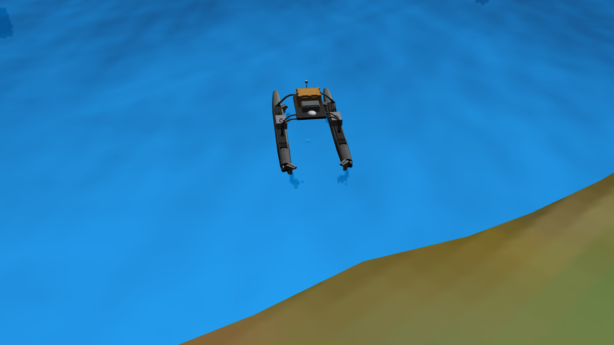

# 地图1场景与 WAM-V

地图1系列使用普通 SDF 世界文件，公共模型通过 `<include>` 引用。地图文件只描述环境参数、实例名称、位置和附加障碍物；船体和海浪参数集中维护。

以下为修复后的 Gazebo 实际渲染截图，使用临时观察相机拍摄；该相机不属于地图定义。



| 地图 | 行数 | 附加障碍物 | Gazebo 顶层模型数 |
| --- | ---: | --- | ---: |
| `地图1-无障碍.world` | 190 | 无 | 23 |
| `地图1-静态未知.world` | 220 | 6 个固定平台 | 29 |
| `map1_3.world` | 215 | 3 个固定平台、2 个浮标 | 28 |

“无障碍”指没有附加测试障碍物，岸线、原有的 12 个码头及地面站仍然保留。地图2系列没有修改。

## 启动

在项目的 `catkin_ws` 目录加载环境：

```bash
source /opt/ros/noetic/setup.bash
source ../depend_ws/devel/setup.bash
source devel/setup.bash --extend
```

安装传感器二进制依赖；三路相机使用已有的 `gazebo_plugins`：

```bash
sudo apt-get install --no-install-recommends \
  ros-noetic-hector-gazebo-plugins ros-noetic-velodyne-gazebo-plugins
```

加载无障碍版：

```bash
roslaunch ocean_simulation_gazebo world_text.launch \
  world:="$(rospack find ocean_simulation_gazebo)/worlds/usv_path_planning/地图1-无障碍.world" \
  verbose:=true
```

将文件名替换为其他地图即可切换。`world_text.launch` 的默认文件仍是 `map1_3.world`，并保留 `gui`、`paused`、`verbose` 参数。世界文件自己创建唯一的 `wamv`，此入口不再额外生成船。

GUI 保留原地图的总览视角；查看船体细节时，可在模型列表中定位 `wamv` 并聚焦。

该 launch 通过 ROS 包位置配置模型、材质和插件搜索路径。它需要已加载的依赖工作区，包含 `wamv_description`、`wamv_gazebo`、`vrx_gazebo`、`wave_gazebo` 和相关动力学插件。GPU 雷达、相机及海面渲染需要可用的 OpenGL 显示环境；`gui:=false` 仅关闭客户端窗口。

### 没有 sudo 权限时的本地插件安装

本次环境无法免密 sudo，因此下载了同版本 Noetic 二进制包，并将动态库安装到当前工作区的 `devel/lib`，没有改动系统软件包数据库或第三方源码。以下命令可在 `catkin_ws` 目录重现：

```bash
map1_ws="$PWD"
map1_prefix="$map1_ws/.cache/map1-sensor-packages"
mkdir -p "$map1_prefix/downloads" "$map1_ws/devel/lib"
(
  cd "$map1_prefix/downloads"
  apt-get download ros-noetic-hector-gazebo-plugins ros-noetic-velodyne-gazebo-plugins
)
for map1_deb in "$map1_prefix"/downloads/*.deb; do
  dpkg-deb -x "$map1_deb" "$map1_prefix"
done
cp -an "$map1_prefix/opt/ros/noetic/lib/." "$map1_ws/devel/lib/"
```

该方法使用现有系统中的依赖库；若 Gazebo 报告其他共享库缺失，应先补齐对应依赖。清空 `devel` 后需要重新安装这些库，或者改用上面的标准系统安装。`package.xml` 始终声明正常的 ROS 运行依赖。

## 基础 Xacro

`地图1-无障碍.world.xacro` 是可显式生成的基础示例，默认结果与普通无障碍版等价，提供四个参数：

| 参数 | 默认值 | 单位 |
| --- | ---: | --- |
| `boat_x` | -570 | 米 |
| `boat_y` | 167 | 米 |
| `boat_z` | 0.1 | 米 |
| `boat_yaw` | 1 | 弧度 |

```bash
rosrun xacro xacro \
  "$(rospack find ocean_simulation_gazebo)/worlds/usv_path_planning/地图1-无障碍.world.xacro" \
  -o /tmp/map1-example.world

# 例如调整出生位置和朝向
rosrun xacro xacro \
  "$(rospack find ocean_simulation_gazebo)/worlds/usv_path_planning/地图1-无障碍.world.xacro" \
  boat_x:=-580 boat_y:=170 boat_z:=0.2 boat_yaw:=0.5 \
  -o /tmp/map1-moved.world

roslaunch ocean_simulation_gazebo world_text.launch world:=/tmp/map1-moved.world
```

启动普通 `.world` 时不会执行 Xacro，也不会覆盖现有地图。修改无障碍版公共布局后，同步基础模板，并运行下面的等价性测试。

## 模型维护

- `models/vehicle/wamv/` 保存原船的 13 个 link、12 个 joint、四推进器、全部传感器和插件，船的位置由世界文件决定。
- 船内的 23 处旧绝对路径已替换为 `model://`，复用 `wamv_description`、`wamv_gazebo`、`vrx_gazebo` 的 11 个网格及原纹理。
- `models/other/map1_ocean/` 保留原海浪及渲染参数，实例名必须保持 `ocean_waves`，供浮力和船体动力学插件查找。
- 2018 码头复用 VRX 的 `dock_2018_dynamic`；2022 码头通过包内 `map1_dock_2022` 复用原动态基座和标牌，修正原模板不存在的连接点，连接至实际存在的基座脊柱块。标牌位置不变，第三方模型文件不变。
- 地图不再含运行快照 `<state>`；每次从 `<include>/<pose>` 指定的初始位置开始。船的默认位姿为 `-570 167 0.1 0 0 1`。

## 控制和传感器接口

所有原有 `/wamv/...` 接口保持不变。更新率按仿真时间计算，实时运行速度取决于渲染性能。

| 内容 | 话题 | 类型 | 配置更新率 |
| --- | --- | --- | ---: |
| 三路相机 | `/wamv/sensors/cameras/{front_left_camera,front_right_camera,middle_right_camera}/image_raw` | `sensor_msgs/Image`，1280×720 | 30 Hz |
| 相机标定 | 同一路径下的 `camera_info` | `sensor_msgs/CameraInfo` | 30 Hz |
| 16 线雷达 | `/wamv/sensors/lidars/lidar_wamv/points` | `sensor_msgs/PointCloud2`，含 `ring`、`time` | 10 Hz |
| GPS | `/wamv/sensors/gps/gps/fix` | `sensor_msgs/NavSatFix` | 15 Hz |
| GPS 速度 | `/wamv/sensors/gps/gps/fix_velocity` | `geometry_msgs/Vector3Stamped` | 15 Hz |
| IMU | `/wamv/sensors/imu/imu/data` | `sensor_msgs/Imu` | 15 Hz |
| 声学 pinger | `/wamv/sensors/pingers/pinger/range_bearing` | `usv_msgs/RangeBearing` | 1 Hz |

四个推进器的命令为 `/wamv/thrusters/{left_front,right_front,left_rear,right_rear}_thrust_cmd`（`std_msgs/Float32`），转角命令为对应的 `*_thrust_angle`。原推力插件的命令超时为 1 秒。

检查示例：

```bash
rostopic echo -n 1 /wamv/sensors/gps/gps/fix
rostopic echo -n 1 /wamv/sensors/imu/imu/data
rostopic echo -n 1 /wamv/sensors/lidars/lidar_wamv/points/header
rostopic echo -n 1 /wamv/sensors/pingers/pinger/range_bearing
rostopic hz /wamv/sensors/cameras/front_left_camera/image_raw
rostopic hz /wamv/sensors/lidars/lidar_wamv/points
```

## 回归检查

```bash
cd "$(rospack find ocean_simulation_gazebo)"
python3 -m unittest discover -s test -p 'test_map1_worlds.py' -v

# 先加载 Gazebo 的环境，再检查 SDF；模型搜索路径与 launch 保持一致
source /usr/share/gazebo/setup.sh
export GAZEBO_MODEL_PATH="$(rospack find ocean_simulation_gazebo)/models/vehicle:$(rospack find ocean_simulation_gazebo)/models/other:$(rospack find wamv_description)/models:$(rospack find wamv_gazebo)/models:$(rospack find vrx_gazebo)/models:$(rospack find wave_gazebo)/world_models:$(rospack find wave_gazebo)/models:$GAZEBO_MODEL_PATH"
gz sdf -k worlds/usv_path_planning/地图1-无障碍.world
gz sdf -k worlds/usv_path_planning/地图1-静态未知.world
gz sdf -k worlds/usv_path_planning/map1_3.world
```

回归测试覆盖布局和障碍物差异、船体与控制接口、资源和纹理可解析性、Xacro 默认等价性及位置参数，以及 2022 码头的连接引用。

## 本次验证记录（2026-11-04）

在独立 ROS/Gazebo 端口逐张启动三份最终地图，使用实际 OpenGL 渲染，验证完毕后关闭测试进程。船体和附件显示正常，三份地图均没有资源、插件或码头关节加载失败。

| 地图 | 顶层模型数 | 船基座漂浮高度 Z（米） | 低推力前进距离（米） | 推力结束时速度（m/s） | 停止后速度（m/s） |
| --- | ---: | ---: | ---: | ---: | ---: |
| 无障碍 | 23 | -0.151 | 1.019 | 0.258 | 0.041 |
| 静态未知 | 29 | -0.118 | 1.020 | 0.301 | 0.077 |
| `map1_3` | 28 | -0.122 | 1.019 | 0.300 | 0.068 |

运动测试向四个推进器持续发送 `0.2` 命令 6 个仿真秒，随后持续发送零命令 8 个仿真秒。基座坐标位于水面以下属于该船原始几何和浮力模型的正常结果。

全部地图的三路相机及 CameraInfo 实测约 30.30 Hz，GPS/IMU 约 14.93 Hz，16 线点云约 10 Hz，声学 pinger 约 1 Hz，均按消息时间戳计算。检查了非空图像、相机标定、有限点云坐标、有效 GPS 数值、归一化 IMU 四元数和有限声学量测。

5 项自动回归检查通过；三份世界及共用模型通过 Gazebo SDF 检查。基础 Xacro 的默认输出与无障碍版语义等价，修改位置参数后结果正确。CMake 配置与临时前缀安装通过，地图、模型、模板、文档和截图均正确安装。地图2文件与修改前的 SHA-256 一致。
