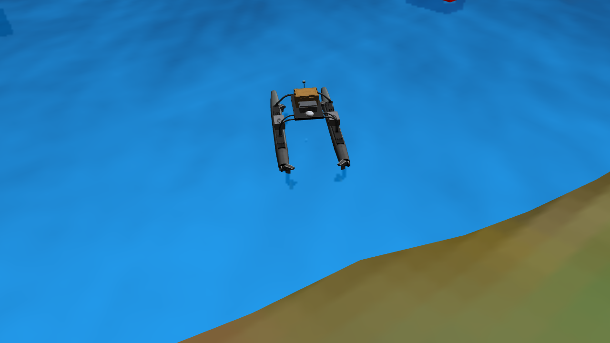

# 地图2场景与 WAM-V

地图2使用普通 SDF 世界文件，通过 `<include>` 复用海浪和静态码头。地图只维护环境参数、环境模型布局和附加障碍物；共用无人船由 `demo_usv.launch` 放置，详见 [Demo 使用说明](demo_launches.md)。

以下为无障碍版的 Gazebo 实际渲染截图，由临时观察相机拍摄；该相机不属于地图定义。



| 地图 | 行数 | 附加障碍物 | 环境模型数 |
| --- | ---: | --- | ---: |
| `map2-2.world` | 200 | 无 | 25 |
| `map2-1.world` | 300 | 19 个固定平台块、1 个浮标 | 45 |

“无障碍”指没有附加测试障碍物；原有岸线、地面站和15个码头均保留。静态未知版的19个平台块包括3个边界标记，以及4组各叠放4层的平台；浮标固定在地图位姿，需要运动时由 `std_usv` 实验入口调用本包的可选脚本更新XY。

## 启动与依赖

在项目的 `catkin_ws` 目录加载环境：

```bash
source /opt/ros/noetic/setup.bash
source ../depend_ws/devel/setup.bash
source devel/setup.bash --extend

# 无障碍版
roslaunch ocean_simulation_gazebo demo_usv.launch \
  world:="$(rospack find ocean_simulation_gazebo)/worlds/usv_path_planning/map2-2.world" \
  verbose:=true

# 静态未知版，单独启动
roslaunch ocean_simulation_gazebo demo_usv.launch \
  world:="$(rospack find ocean_simulation_gazebo)/worlds/usv_path_planning/map2-1.world" \
  verbose:=true
```

Demo 支持 `world`、`gui`、`paused`、`verbose` 和六个 `usv_*` 位姿参数，每次创建一个 `wamv`。`world_text.launch` 仅加载环境，不再出现无人船。GUI 保留地图2原来的俯视总览，查看船体细节时可聚焦模型列表中的 `wamv`。

依赖与地图1相同：依赖工作区提供 VRX、WAM-V 和海浪模型及动力学插件；GPS、IMU、GPU 雷达继续使用原插件。标准安装命令为：

```bash
sudo apt-get install --no-install-recommends \
  ros-noetic-hector-gazebo-plugins ros-noetic-velodyne-gazebo-plugins
```

当前工作区已经有地图1修复时安装到 `devel/lib` 的这两组插件，无需重复安装。本地安装方式、OpenGL 要求和清理 `devel` 后的恢复步骤见 [地图1说明](map1_worlds.md#没有-sudo-权限时的本地插件安装)。

## 共用模型与布局

- 共用 WAM-V：保留 13 个 link、12 个 joint、四个推进器和全部传感器，由 Demo 直接加载其 SDF。默认初始位姿为 `-570 167 0.1 0 0 1`，通过 launch 参数覆盖，角度使用弧度。每份旧地图中的 23 处失效绝对网格路径随内嵌船体一起移除，资源通过共用船模型的 `model://` URI 解析。
- `model://map1_ocean`：沿用已有共用海浪模型，实例名仍为 `ocean_waves`，海浪、反射和折射参数与原地图2一致。资源名中的 `map1` 只表示模型最初的来源。
- 2018、2022码头分别使用 `model://dock_2018_static`、`model://dock_2022_static`。全部15个码头固定放置，移除浮力与运动关节，保留各浮台碰撞盒、通道和标牌；三个 `*_clone` 实例保留原始高度及倾斜姿态，静态化后固定在这些定义的位姿。
- 每个2018码头含两块红墙和两块绿块，均为具备碰撞、相机及雷达可见性的静态实体障碍，并计入 `std_usv` 的已知地图；包含原有克隆码头上的几何。红墙为8×1.5×2m，绿块为1.5×4×2m，位置与原模型一致；绿色区域不可通航，2022码头未启用的示意区域保持现状。默认起终点在已知地图2m膨胀后仍连通；地图2-1新增红墙后的局部规划停滞及本轮回归结果分别记录于 `std_usv/docs/validation.md`。
- 浮标使用 `robotx_light_buoy_static`，小球使用 `blue_projectile_static`；平台等既有静态模型继续复用。所有环境引用显式设置静态属性。`std_usv` 可通过位姿服务移动浮标3，仅更新XY，保留初始z=0.5及姿态；不会恢复浮力或受力运动。
- 岸线、柱子、天线、地面站、小球、平台和浮标继续引用现有依赖模型，不复制第三方资源、不修改第三方源码。
- 删除 `<state>` 运行快照，使用原模型定义中的 `<pose>` 作为初始布局；地理原点、物理参数、风、光照和 GUI 视角保持原值。
- 修复静态未知版 `dynamic_obstacle_3` 的坐标格式：原来的 `-498.5, 196.0, 0.5 0 0 0` 改为空格分隔的 `-498.5 196.0 0.5 0 0 0`，位置数值不变。

## 基础 Xacro

`map2_base.world.xacro` 显式生成与 `map2-2.world` 等价的纯环境，不在 launch 中自动处理。原 `boat_*` 参数已移除，船位姿由 Demo 的 `usv_*` 参数指定：

```bash
rosrun xacro xacro \
  "$(rospack find ocean_simulation_gazebo)/worlds/usv_path_planning/map2_base.world.xacro" \
  -o /tmp/map2-example.world

roslaunch ocean_simulation_gazebo demo_usv.launch world:=/tmp/map2-example.world \
  usv_x:=-580 usv_y:=170 usv_z:=0.2 usv_yaw:=0.5
```

修改无障碍版公共布局后，同步基础模板并运行等价性检查。

## 控制、传感器与回归检查

全部原有 `/wamv/...` 控制和传感器话题保持不变，完整接口表见 [地图1说明](map1_worlds.md#控制和传感器接口)。例如：

```bash
rostopic hz /wamv/sensors/cameras/front_left_camera/image_raw
rostopic hz /wamv/sensors/cameras/front_right_camera/image_raw
rostopic hz /wamv/sensors/cameras/middle_right_camera/image_raw
rostopic echo -n 1 /wamv/sensors/cameras/front_left_camera/camera_info
rostopic hz /wamv/sensors/lidars/lidar_wamv/points
rostopic echo -n 1 /wamv/sensors/gps/gps/fix
rostopic echo -n 1 /wamv/sensors/gps/gps/fix_velocity
rostopic echo -n 1 /wamv/sensors/imu/imu/data
rostopic echo -n 1 /wamv/sensors/pingers/pinger/range_bearing
```

文件与布局检查不需要启动仿真：

```bash
cd "$(rospack find ocean_simulation_gazebo)"
python3 -m unittest discover -s test -p 'test_map[12]_worlds.py' -v

source /usr/share/gazebo/setup.sh
export GAZEBO_MODEL_PATH="$(rospack find ocean_simulation_gazebo)/models/vehicle:$(rospack find ocean_simulation_gazebo)/models/other:$(rospack find wamv_description)/models:$(rospack find wamv_gazebo)/models:$(rospack find vrx_gazebo)/models:$(rospack find wave_gazebo)/world_models:$(rospack find wave_gazebo)/models:$GAZEBO_MODEL_PATH"
gz sdf -k worlds/usv_path_planning/map2-2.world
gz sdf -k worlds/usv_path_planning/map2-1.world
```

地图2回归检查覆盖环境模型名称与数量、共用布局、三个新增码头的完整位姿、20个障碍物实例的位置及类型、环境参数、模型资源及静态属性，以及纯环境Xacro的默认等价性。Demo参数及运行检查见 [Demo使用说明](demo_launches.md)。

## 地图模块化时的实测记录（2026-11-04）

以下记录来自机器人放置迁移前的地图模块化版本；当前世界文件已移除船，最新启动方式及实测结果见 [Demo 使用说明](demo_launches.md)。

使用独立 ROS/Gazebo 端口分别启动最终两张地图，启用实际 OpenGL 渲染。在暂停状态逐一核对全部模型的名称、数量、位置和姿态后，恢复仿真并采集传感器数据。两张地图各只有一个 `wamv`，船体及附件正常显示，日志中没有资源缺失、传感器插件加载失败或码头关节错误。

| 地图 | 顶层模型数 | 漂浮时船基座 Z（米） | 低推力前进距离（米） | 推力结束速度（m/s） | 停止后速度（m/s） |
| --- | ---: | ---: | ---: | ---: | ---: |
| 无障碍 | 26 | -0.107 | 1.021 | 0.259 | 0.038 |
| 静态未知 | 46 | -0.106 | 1.021 | 0.259 | 0.038 |

运动检查向四个推进器持续发送 `0.2` 命令 6 个仿真秒，再发送零命令 8 个仿真秒；前进方向与船艏一致，归零后速度明显下降。基座坐标在水面以下符合该船的原始几何与浮力模型。

| 传感器输出 | 两张地图按消息时间戳测得的频率 | 有效性检查 |
| --- | ---: | --- |
| 三路图像及各自的 CameraInfo | 约 30.30 Hz | 1280×720 非空图像、有效相机内参 |
| 16 线雷达点云 | 10 Hz | 非空有限坐标，含 `ring`、`time` 字段 |
| GPS 定位及 GPS 速度 | 约 14.93 Hz | 有限的经纬高及三轴速度 |
| IMU | 约 14.93 Hz | 单位四元数、有限加速度 |
| 声学 pinger | 约 1 Hz | 有限距离、方位角和仰角 |

两张地图均持续收到所有上述话题的数据。地图1与地图2合计 10 项文件回归检查通过，两份地图通过 `gz sdf -k`。基础 Xacro 默认结果与无障碍版语义等价，修改四个船位姿参数后结果正确。CMake 配置及临时前缀安装检查通过，世界、模板、文档和截图均纳入安装。

地图1的三份 `.world` 和基础 Xacro 内容与本次修复前的 SHA-256 一致；仅同步了其测试及文档中已经过期的文件名。保留启动文件已有默认地图选择及未提交改动，未执行 Git 提交。
