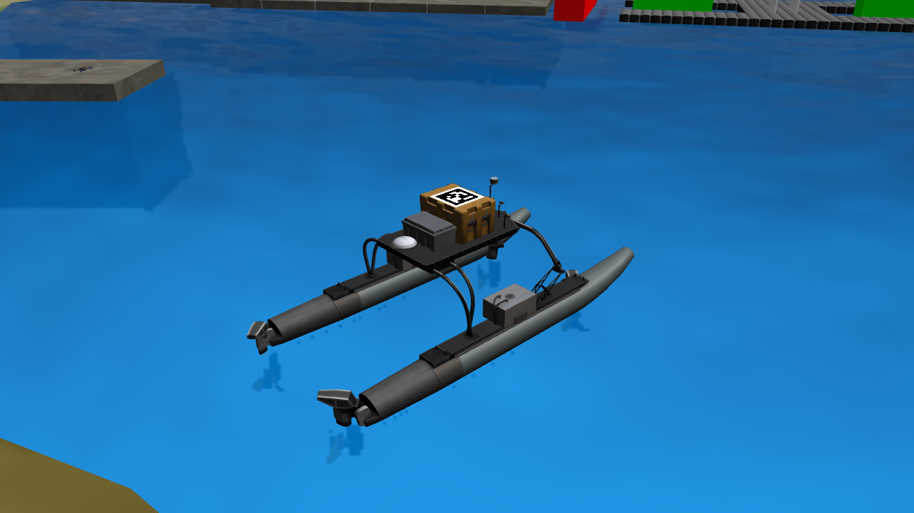
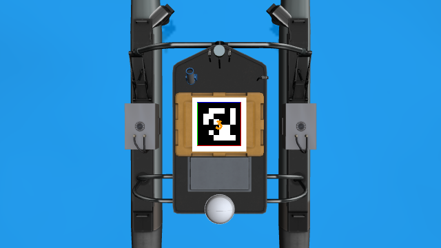
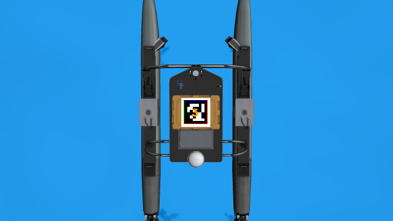
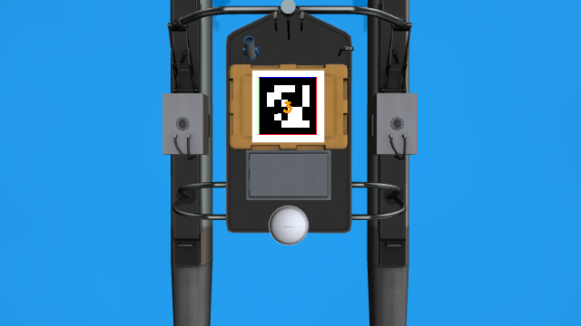

# wamv_apriltag

船机协同场景使用的 WAM-V 派生模型。在中央较高设备箱的箱盖上贴一枚朝上的 AprilTag，供无人机降落时进行视觉定位。

## 模型与标记

模型保留原 `wamv` 的浮筒、设备箱、四推进器、传感器、质量、惯性和碰撞体，只在 `wamv/base_link` 内增加 `apriltag_landing_target` visual。标签没有额外的质量、碰撞体或关节，随船体运动；原箱体碰撞面继续存在。

| 项目 | 数值 |
| --- | --- |
| AprilTag 家族与 ID | `tag36h11`，`3` |
| 含白边的贴图边长 | `0.50 m` |
| 黑色外边边长 / 检测器 `tag_size` | `0.40 m` |
| 每侧白边 | `0.05 m` |
| 中心相对 `wamv/base_link` 的位置 | `(0.033, 0, 1.7611) m` |
| visual RPY | `(0, 0, 0)` rad，法向为船体 `+Z` |
| 原箱盖网格顶面 | 约 `z=1.76007 m` |
| 原箱体碰撞面顶面 | `z=1.765 m` |

箱盖实际平顶约为 `0.558 × 0.789 m`。标签沿较窄方向每侧留约 `2.9 cm`，相对网格顶面抬高约 `1 mm`，避免共面闪烁。尺寸与位置均为船体系数值，不是 Gazebo 世界坐标。

纹理为 1000×1000 的黑白图像：中央 800×800 像素为标准标记，每侧外加 100 像素白边。采用不受光照影响的材质，关闭纹理插值和标签阴影投射。船体网格仍复用原模型已有的 WAM-V/VRX 依赖；标签材质和纹理位于本模型目录。

## 启动

```bash
# 船机协同入口默认使用本模型，Gazebo 实例名仍为 wamv。
roslaunch ocean_simulation_gazebo demo_uav_usv.launch

# 切回原船。
roslaunch ocean_simulation_gazebo demo_uav_usv.launch usv_model:=wamv
```

纯无人船入口仍使用原 `wamv`。`usv_model` 只选择资源，不改变运行实例名或 `/wamv/...` 接口；同一仿真中不通过该参数同时生成两艘船。

识别本模型时，使用 `tag_family=tag36h11`、`tag_id=3`、`tag_size=0.40`。例如，现有 `target_estimator_test.launch` 支持 `tag_size:=0.40`；其车辆状态、IMU 输入和相机外参仍需按协同场景配置。原地面标签及感知 launch 的 `0.20 m` 默认值不变。

## 纹理再生成

在本目录执行以下命令可确定性地生成同一编码。OpenCV 仅用于生成资源，加载模型不需要新增 Python 依赖。

```bash
python3 - <<'PY'
from pathlib import Path
import cv2

dictionary = cv2.aruco.Dictionary_get(cv2.aruco.DICT_APRILTAG_36h11)
marker = cv2.aruco.drawMarker(dictionary, 3, 800, borderBits=1)
texture = cv2.copyMakeBorder(marker, 100, 100, 100, 100,
                             cv2.BORDER_CONSTANT, value=255)
destination = Path('materials/textures/tag36h11_id3.png')
destination.parent.mkdir(parents=True, exist_ok=True)
assert cv2.imwrite(str(destination), texture)
PY
```

## Gazebo 验证记录（2026-11-07）

- 新旧模型均通过 `gz sdf -k`。去除新资源名和唯一新增 visual 后，XML 结构完全一致，原船的碰撞、惯性、关节、插件和传感器配置一致。
- 现有 19 项场景检查通过；协同入口默认使用新模型、`usv_model:=wamv` 切回原船、纯无人船入口继续使用原船的 launch 展开均通过。
- 协同场景以 `gui:=false`、独立 ROS/Gazebo master 实际运行。添加验证相机前共有 47 个模型，`wamv`、`uav_1` 均存在，`/uav_1/mavros/state` 已连接。
- 使用固定验证相机，图像为 640×360，`fx=fy=477.296554`、`cx=320`、`cy=180`、零畸变，与无人机相机内参一致。在标签面上方名义 3 m、5 m 处，`apriltag_ros` 和 OpenCV 的 AprilTag 检测模式均识别出 ID 3；ROS 检测深度分别约为 3.030 m、5.021 m。海浪和船体运动会改变瞬时距离。
- 四个推进器各发送 `0.2` 命令 3 个仿真秒，再归零；实测船体平移约 `0.360 m`，固定相机仍识别到随船移动的 ID 3。
- 验收检测器使用 `tag_threads=1`、`num_worker_threads=2` 限制并发；OpenCV 使用 `CORNER_REFINE_APRILTAG`。截图中的框线和 ID 来自 `apriltag_ros` 的检测图像输出，实测数据见 [validation.json](preview/validation.json)。验收结束后已关闭本次启动的进程。

俯斜视外观：



3 m、5 m 视距检测：





船体运动后的检测：


